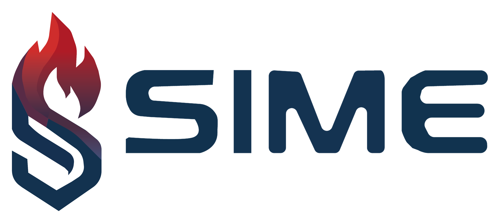
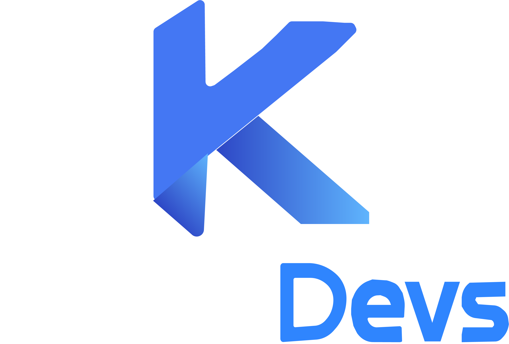

<div align="center">
  

# SIME (Sistema Interactivo de Mapa de Extintores)

**Gestión, trazabilidad y control de extintores mediante navegación progresiva y mapeo espacial.**

  
  
  <p><em>Desarrollado con pasión por KoduDevs</em></p>
</div>

---

## 📖 Descripción del Proyecto

**SIME** es una aplicación web SPA (Single Page Application) diseñada para optimizar la gestión y monitoreo del equipo contra incendios en instituciones. El sistema permite administrar extintores, planificar mantenimientos, registrar eventos de uso y visualizar la distribución del equipo a través de un mapa interactivo con navegación progresiva.

### 🎯 Objetivos Principales

- **Trazabilidad:** Ciclo de vida completo del extintor (registro, uso, recarga, baja).
- **Prevención:** Sistema de alertas automatizadas para mantenimientos y fechas de caducidad.
- **Mapeo Espacial:** Interfaz gráfica interactiva con funcionalidad Drag & Drop para ubicar los extintores en sus planos físicos correspondientes.

---

## 🛠️ Stack Tecnológico

Este proyecto está construido bajo una arquitectura moderna y robusta:

- **Backend:** Laravel 11 (PHP 8.x)
- **Frontend:** React.js con JavaScript
- **Comunicación:** Inertia.js (Breeze) - _Sin APIs REST, comunicación directa y fluida._
- **Base de Datos:** MySQL / MariaDB
- **Estilos:** Tailwind CSS

---

## ⚙️ Arquitectura de Módulos (Backend)

El sistema se divide en dueños y responsabilidades claras, manteniendo controladores delgados y servicios reutilizables:

- **1. Acceso y Estructura:** Gestión de autenticación, recuperación de contraseñas y middleware público/privado.
- **2. Mapa Interactivo:** Navegación progresiva (Instalación → Piso → Ubicación) y Drag & Drop espacial.
- **3. Extintores:** Registro central de equipos y manejo de bajas lógicas.
- **4. Agenda:** Programación de mantenimientos y capacitaciones.
- **5. Historial:** Registro de eventos de uso e impacto directo en el estatus físico del equipo.
- **6. Alertas:** Motor automatizado que evalúa fechas y estatus diarios.
- **7. Dashboard:** Métricas agrupadas directamente desde consultas SQL optimizadas.
- **8. Consulta Pública:** Acceso sin login a módulos informativos.

---

## 🚀 Requisitos Previos

Asegúrate de tener instalados en tu entorno local:

- PHP >= 8.2
- Composer
- Node.js y npm
- Sqlite / PostgreSQL

---

## 💻 Instalación y Configuración

Sigue estos pasos para levantar el entorno de desarrollo:

**1. Clonar el repositorio**

```bash
git clone git@github.com:tu-usuario/sime.git
cd sime
```

**2. Instalar dependencias de PHP y Node**

```bash
composer install
npm install
```

**3. Configurar el entorno**
Copia el archivo de ejemplo y genera la clave de la aplicación.

```bash
cp .env.example .env
php artisan key:generate
```

**4. Configurar la base de datos**
Abre el archivo `.env` y configura tus credenciales de base de datos (`DB_DATABASE`, `DB_USERNAME`, `DB_PASSWORD`).

**5. Ejecutar migraciones y seeders**
Aviso: Esto creará las tablas y los catálogos base necesarios para el sistema.

```bash
php artisan migrate:fresh --seed
```

**6. Levantar los servidores**
Necesitarás una terminal corriendo y la app HERD en ejecución.

Terminal (Frontend):

```bash
npm run dev
```

---

## 🧑‍💻 Flujo de Trabajo (Git)

Seguimos una metodología de ramas para mantener la rama principal estable:

- **Ramas nuevas:** `area/descripcion-corta` (Ej. `back/mapa-coordenadas`).
- **Commits:** Uso de Conventional Commits (Ej. `feat: agregar servicio arbol de ubicaciones`).
- **Merge:** Fusionar mediante Pull Requests hacia `main`.

---

<div align="center">
  <p>© 2026 KoduDevs - Todos los derechos reservados.</p>
</div>
